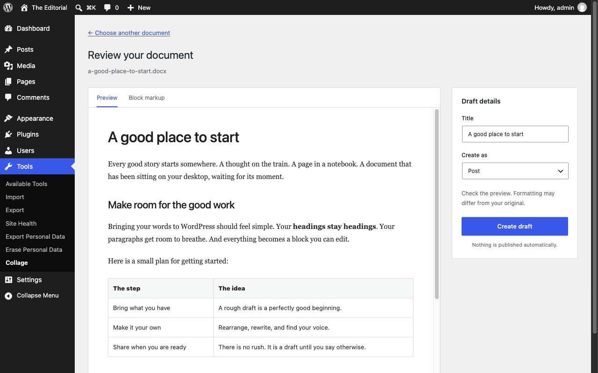

# Collage

Turn documents into editable WordPress blocks. Drop in a file, check the preview,
and save it as a draft post or page.

**[Download Collage](https://github.com/adamziel/collage/releases/latest/download/collage.zip)**
· **[Try the importer in Playground](https://playground.wordpress.net/?blueprint-url=https%3A%2F%2Fraw.githubusercontent.com%2Fadamziel%2Fcollage%2Fmain%2Fplayground%2Fblueprint.json)**
· **[Open a sample draft in Playground](https://playground.wordpress.net/?blueprint-url=https%3A%2F%2Fraw.githubusercontent.com%2Fadamziel%2Fcollage%2Fmain%2Fplayground%2Fsample-draft.json)**



## Install and import

1. Download `collage.zip`. In WordPress, go to **Plugins → Add Plugin → Upload Plugin**.
2. Install and activate Collage, then open **Tools → Collage**.
3. Drop a document or choose **Try a sample document**.
4. Review the blocks, create a draft, and open it in the editor.

Requires WordPress 6.7+ and PHP 8.2+. Use the release ZIP rather than GitHub's
source archive: the release includes the conversion libraries. The readers use
DOM, Intl, Mbstring, Zip, and Zlib. GD or Imagick helps WordPress make image sizes.

The first Playground demo opens the dropzone with three bundled examples. The
second imports the Word sample as a draft; open **A good place to start** to edit
its headings and table. Playground runs in your browser and the demo
starts with a fresh test site.

## Run locally

Requirements: PHP 8.2+, Composer, Git, curl, unzip, and the PHP DOM, Intl,
Mbstring, Zip, GD, and PDO SQLite extensions.

```sh
bash scripts/setup.sh
bash scripts/serve.sh
```

Open [the importer](http://127.0.0.1:8890/wp-admin/tools.php?page=pandoc-importer).
Local-only login: **admin / pandoc-local-only**.

The test site, database, downloaded source, and tools live in `.local/`.
The server listens on loopback only. Do not expose this test site to the internet.
The plugin is linked into the test site, so reloading the page picks up edits.

## What works

- A keyboard-accessible file picker and drag-and-drop, with file type and size checks.
- Word, PDF, Markdown, HTML, EPUB, OpenDocument, RTF, text, PowerPoint, Excel, and CSV.
- One sample link, with two more sample documents in Help.
- Sandboxed document preview and a block-markup view with a copy button.
- A choice of post or page, with a title you can change before saving.
- Embedded PNG, JPEG, GIF, and WebP images added to the Media Library on draft creation.
- The current user’s last 20 imports, linked to the editor.
- WordPress admin styles, responsive layouts, and the user’s admin accent color.

## Request model

1. One request uploads the complete file, reads it, converts it, and returns a preview.
2. After review, a separate request saves the draft and its images.

Conversion cannot pause or resume between requests. If it times out before the
preview is saved, the file must be sent and converted again. The one-hour preview
record holds the completed result, not progress through an unfinished conversion.
Large-file support would need saved input and conversion progress, with bounded
steps that can safely run again after a failed request. Splitting only the upload
would not remove the conversion’s time and memory limits.

The bundled PDF code has page-range extraction and a layer that combines page
results while preserving cross-page context. The plugin does not use that path
yet. EPUB has a streaming reader, but its running iterator is not a saved job that
another HTTP request can resume. There is no common cross-request resume path for
all the supported formats.

## Data and limits

Files go to the WordPress server, never to an outside converter. PHP removes the
temporary upload after the request. A converted preview, including embedded image
bodies, is kept in a user-bound WordPress transient for one hour. Expired database
rows are removed by normal WordPress cleanup. Creating a draft replaces that
preview with its post ID so a retry can return the same draft.

Previewing creates no post or Media Library item. Creating a draft saves its
content and accepted images. The original document is not kept. Existing files
on the computer do not change. External image URLs are preserved, but the preview
does not load them. Opening the draft in the editor or viewing it on the site may
load those external images. Media Library files can also be served by their
URLs before their draft is published.

- Source files: at most 8 MB, or the site’s lower upload limit.
- ZIP documents: at most 2,048 entries, 32 MB total unpacked, an overall 100×
  expansion ratio, and 8 MB per entry. Entries are checked before conversion.
- Images: JPEG, PNG, GIF, and WebP only; at most 5 MB and 20 million pixels each,
  with 12 MB total image bytes per document. SVG is not imported.
- HTML and block attributes are filtered with WordPress KSES. Unknown or dynamic
  blocks are rejected. The preview has an empty iframe sandbox and a strict CSP.
- Conversion is never given a server source path. Linked local files are not read.
- The REST API requires a signed-in user with `edit_posts` and WordPress’s normal
  REST nonce. Page creation and image uploads have separate capability checks.
- Table column widths are dropped because the native table block cannot save
  `colgroup` widths. Cells remain editable; the browser sizes the columns.

## Current boundaries

**This is the first release.** Use it with trusted users and documents. Test the
formats and documents you rely on before rolling it out to a live site.

PDF import is experimental. Reading order, tables, images, and scanned pages can
be incomplete. There is no OCR. A warning is shown for every PDF. Compare the draft
against the source before publishing. Other readers also have format-specific
limits; support does not mean every feature survives conversion.

Conversion runs in a web request. It has no background worker, per-user request
quota, or resumable job. Two concurrent saves of the same preview can create
two drafts. The UI is currently in English.
The local PHP server sets a 256 MB memory limit and a 45-second execution limit;
the plugin itself does not change the host’s resource settings.

## Build from source

```sh
bash scripts/dependencies.sh
php scripts/build.php
```

This fetches the pinned conversion source and generates its Composer class map.
No Node build or WordPress install is needed to make the ZIP. The DOCX example
is checked in; `php scripts/make-sample.php` regenerates it when the example changes.

## Check a build

```sh
php .local/wp-cli.phar eval-file tests/integration.php --path=.local/wordpress
php tests/http.php                 # requires the local server
node --check assets/admin.js
bash scripts/check-submission.sh
bash scripts/test-playground.sh
```

The Playground checks require Node 24.18+ and npm 11.16+. See
[Releasing and submitting](RELEASING.md) for the tag and WordPress.org steps.

The installable ZIP is `dist/collage.zip`. Upload it on another WordPress
site through **Plugins → Add Plugin → Upload Plugin**. The ZIP includes the pinned
conversion library. It excludes the local WordPress site, database, and tools.

For native block checks, sign in to the local test site and open
[the block validation page](http://127.0.0.1:8890/pandoc-block-check.php).
It uses the installed WordPress JavaScript parser and block save functions,
checks all three samples and your imported drafts, and shows any invalid blocks.

## Credits

Collage uses the native PHP Pandoc port and MarkerPDF readers from
[adamziel/port-libs](https://github.com/adamziel/port-libs). Conversion runs in PHP;
the Pandoc executable is not required.

See [THIRD-PARTY.txt](THIRD-PARTY.txt) for the library revision and license.
